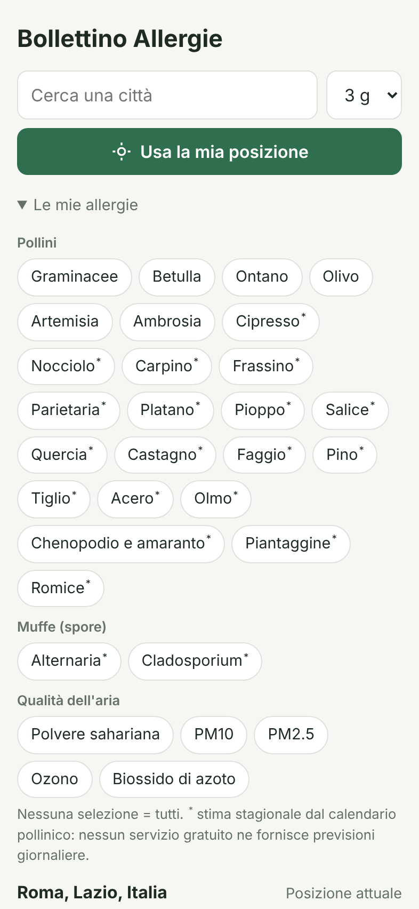
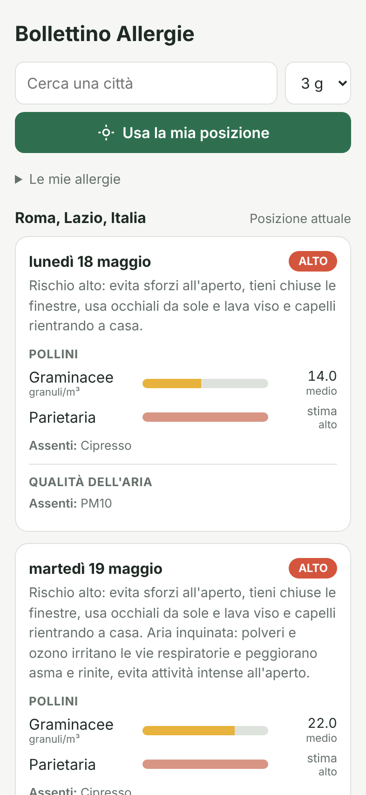
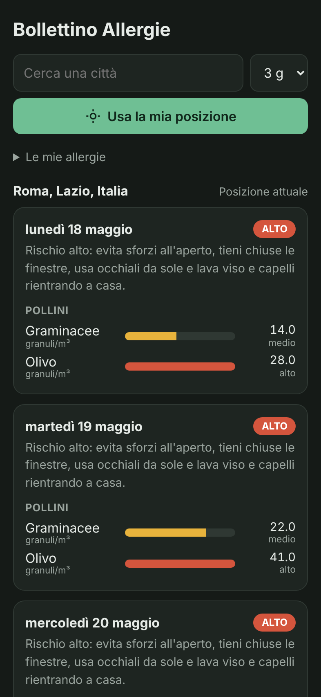
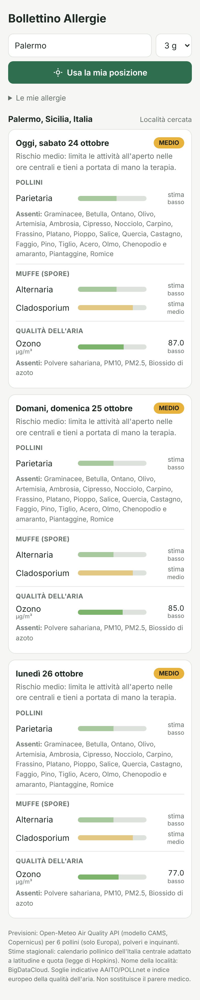
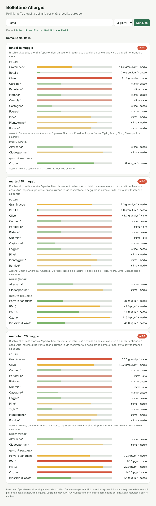

# Bollettino Allergie

Consulta il bollettino delle allergie per una città o località: livelli fino a 4 giorni per
**31 allergeni** (pollini, muffe e inquinanti), con un livello di rischio e un consiglio
pratico per ogni giorno.

| Categoria | Allergeni | Fonte del dato |
|---|---|---|
| Pollini, previsione | Graminacee, Betulla, Ontano, Olivo, Artemisia, Ambrosia | modello CAMS (Copernicus), solo Europa |
| Pollini, stima stagionale | Cipresso, Nocciolo, Carpino, Frassino, Parietaria, Platano, Pioppo, Salice, Quercia, Castagno, Faggio, Pino, Tiglio, Acero, Olmo, Chenopodio e amaranto, Piantaggine, Romice | calendario pollinico, solo Europa |
| Muffe (spore), stima stagionale | Alternaria, Cladosporium | calendario pollinico, solo Europa |
| Qualità dell'aria, previsione | Polvere sahariana, PM10, PM2.5, Ozono, Biossido di azoto | modello CAMS, tutto il mondo |

**Previsione e stima non sono la stessa cosa.** Nessun servizio gratuito fornisce previsioni
giornaliere per cipresso, parietaria, muffe e gli altri pollini: per questi il livello è una
**stima** ricavata dal calendario pollinico dell'Italia centrale, spostata in base a
latitudine e quota con la legge bioclimatica di Hopkins (circa 4 giorni per grado di
latitudine e ogni 122 m di quota). In primavera le fioriture arrivano più tardi a nord e in
quota, in autunno le stagioni tardive finiscono prima. La stima dice *se* quell'allergene è
in stagione in quel periodo, non quanto ce n'è proprio quel giorno. Nell'app e nella riga di
comando le stime sono segnate con `*` e con barre più chiare.

Polveri e inquinanti non sono allergeni, ma irritano le vie respiratorie e peggiorano asma e
rinite allergica.

Non sono inclusi gli allergeni che non dipendono dal luogo né dal giorno (acari, peli di
animali, alimenti, farmaci, punture d'insetto): non hanno un bollettino.

- Nessuna dipendenza esterna: solo Python 3.10+ e la libreria standard.
- Dati gratuiti senza chiave API: [Open-Meteo](https://open-meteo.com/) (geocoding + Air Quality API,
  modello CAMS/Copernicus). Pollini e muffe solo in Europa; polveri e inquinanti ovunque.
- Quattro modi d'uso: **app Android** con geolocalizzazione, riga di comando, interfaccia web,
  libreria Python.

## App Android (APK)

L'app usa il **servizio di localizzazione dello smartphone** per mostrare subito il bollettino
del luogo in cui ti trovi. Scarica l'APK già compilato da
[`dist/BollettinoAllergie-1.1.apk`](dist/BollettinoAllergie-1.1.apk).

| Le mie allergie | Profilo personale | Tema scuro | Palermo, dati reali |
|---|---|---|---|
|  |  |  |  |

*I primi tre screenshot usano i dati simulati di Roma a maggio (vedi Esempi); l'ultimo usa i dati
reali di fine ottobre.*

**Installazione:** apri il file `.apk` sul telefono (Android 8.0 o successivo) e consenti
l'installazione da origini sconosciute quando viene richiesto. Al primo avvio l'app chiede il
permesso di posizione.

**Funzionamento:**
- all'avvio l'app rileva la posizione (tasto *Usa la mia posizione* per aggiornarla) e mostra il
  nome della località e il bollettino a 1-4 giorni;
- chiede solo la **posizione approssimativa**: basta, perché il modello dei pollini ha una
  griglia di circa 10 km, e protegge la privacy;
- se il permesso è negato o il GPS è spento puoi **cercare una città**; al riavvio, se la
  posizione non è disponibile, viene riproposta l'ultima località consultata;
- risultati divisi in pollini, muffe e qualità dell'aria; gli allergeni assenti sono riassunti
  in una riga per non allungare la pagina;
- in *Le mie allergie* scegli tra i 31 allergeni quelli che ti riguardano (la scelta viene
  ricordata, anche quella fatta con la versione 1.0);
- supporta tema chiaro e scuro.

**Come è fatta:** un'app nativa in Kotlin (`android/`) che ottiene la posizione dal
`LocationManager` di Android e la passa all'interfaccia web contenuta nell'app
(`android/app/src/main/assets/www/`). L'interfaccia interroga direttamente Open-Meteo dal
telefono: non serve alcun server. Il nome della località viene da BigDataCloud
(reverse geocoding gratuito, senza chiave). Il catalogo degli allergeni
(`bollettino_allergie/catalogo/allergeni.json`) è condiviso con il pacchetto Python e viene
copiato nell'APK durante la build; la logica (`bollettino.js`) rispecchia quella Python e un
test verifica che diano gli stessi risultati.

**Compilare l'APK** (servono JDK 17+ e l'Android SDK):

```bash
cd android
echo "sdk.dir=/percorso/android-sdk" > local.properties   # oppure ANDROID_HOME
./gradlew assembleDebug
# -> app/build/outputs/apk/debug/app-debug.apk
```

L'APK in `dist/` è firmato con una chiave di debug, quindi va bene per installarlo a mano ma
non per il Play Store. Per pubblicarlo serve una build `release` firmata con una tua chiave.

## Come si usa

### Riga di comando

```bash
python -m bollettino_allergie Milano                          # bollettino a 3 giorni
python -m bollettino_allergie Firenze --giorni 4              # 1-4 giorni
python -m bollettino_allergie Roma -a cipresso,parietaria,pm10 # solo le tue allergie
python -m bollettino_allergie Roma --completo                 # mostra anche gli assenti
python -m bollettino_allergie Bari --json                     # output JSON
python -m bollettino_allergie --elenco                        # tutti gli allergeni disponibili
```

Output (Roma, 20 maggio, dati simulati con un episodio di polvere sahariana; `*` = stima stagionale):

```
2026-05-20  rischio complessivo: ALTO
  Pollini
    Graminacee               35.0   63.0 granuli/m³ █ alto
    Olivo                    19.0   34.2 granuli/m³ ▅ medio
    Parietaria*               2.8   n.d.            █ alto
    Quercia*                  2.5   n.d.            █ alto
    Pino*                     1.8   n.d.            ▅ medio
    ...
    assenti: Betulla, Ontano, Artemisia, Ambrosia, Cipresso, Nocciolo, Frassino, ...
  Muffe (spore)
    Alternaria*               1.2   n.d.            ▂ basso
    Cladosporium*             2.2   n.d.            ▅ medio
  Qualità dell'aria
    Polvere sahariana        70.0  126.0 µg/m³      ▅ medio
    PM10                     60.0  108.0 µg/m³      █ alto
    Ozono                    80.0  144.0 µg/m³      █ alto
    ...
  → Rischio alto: evita sforzi all'aperto, ... Aria inquinata: polveri e ozono irritano ...
```

### Interfaccia web

```bash
python -m bollettino_allergie --web --porta 8000
# apri http://127.0.0.1:8000
```



È disponibile anche l'endpoint JSON:
`GET /api/bollettino?luogo=Roma&giorni=3&allergie=graminacee,cipresso`

### Libreria

```python
from bollettino_allergie import cerca_luogo, scarica_previsioni, crea_bollettino, cerca_allergeni

luogo = cerca_luogo("Torino")
b = crea_bollettino(luogo, scarica_previsioni(luogo, giorni=3),
                    cerca_allergeni(["ambrosia", "parietaria", "alternaria", "ozono"]))
for giorno in b.giorni:
    print(giorno.data, giorno.livello_massimo, giorno.consiglio)
```

## Esempi

`esempi/esempi.py` mostra quattro casi d'uso:

| # | Scenario | Cosa mostra |
|---|----------|-------------|
| 1 | Roma, maggio | Tutti i 31 allergeni: olivo e graminacee previsti, quercia e parietaria stimate, polvere sahariana |
| 2 | Milano, aprile | Profilo personale: Betulaceae, cipresso, platano e, per l'asma, PM10 e NO₂ |
| 3 | Milano, fine agosto | Uso programmatico: giorni da evitare per ambrosia, Alternaria e ozono |
| 4 | Firenze, oggi | Consultazione reale via API (`--live`) |

```bash
python esempi/esempi.py          # scenari 1-3, offline
python esempi/esempi.py --live   # aggiunge lo scenario 4 con dati reali
```

Gli scenari 1-3 usano dati **simulati** in `esempi/dati/` (stesso formato dell'API,
generati da `esempi/genera_dati.py`), così gli esempi sono significativi anche
fuori stagione, quando i pollini reali sono vicini a zero.

## Come si calcola il livello

Per le **previsioni** si calcola il valore giornaliero dalle concentrazioni orarie (media;
picco orario per ozono e biossido di azoto) e lo si confronta con soglie indicative: rete
aerobiologica italiana (AAITO/POLLnet) per i pollini, indice europeo della qualità dell'aria
(EAQI) per gli inquinanti.

| Allergene | Unità | Basso | Medio | Alto |
|-----------|-------|-------|-------|------|
| Graminacee | granuli/m³ | ≥ 0.6 | ≥ 10 | ≥ 30 |
| Betulla, Ontano | granuli/m³ | ≥ 0.6 | ≥ 16 | ≥ 50 |
| Olivo, Artemisia, Ambrosia | granuli/m³ | ≥ 0.6 | ≥ 5 | ≥ 25 |
| Polvere sahariana | µg/m³ | ≥ 20 | ≥ 50 | ≥ 100 |
| PM10 | µg/m³ | ≥ 20 | ≥ 40 | ≥ 50 |
| PM2.5 | µg/m³ | ≥ 10 | ≥ 20 | ≥ 25 |
| Ozono (picco) | µg/m³ | ≥ 50 | ≥ 100 | ≥ 130 |
| Biossido di azoto (picco) | µg/m³ | ≥ 40 | ≥ 90 | ≥ 120 |

Per le **stime stagionali** ogni allergene ha un calendario di 12 valori mensili (0 assente,
1 basso, 2 medio, 3 alto), interpolato giorno per giorno e spostato con la legge di Hopkins.
Soglie e calendari sono nel file `bollettino_allergie/catalogo/allergeni.json`: modificandolo
si aggiornano sia il pacchetto Python sia l'app.

Il rischio complessivo del giorno è il livello più alto tra gli allergeni considerati.
Previsioni e stime sono indicative: il bollettino non sostituisce il parere del medico o
dell'allergologo.

## Test

```bash
python -m unittest -v                          # pacchetto Python
node --test android/test/bollettino.test.js    # logica dell'app Android e confronto con Python
```

I test non richiedono la rete.
