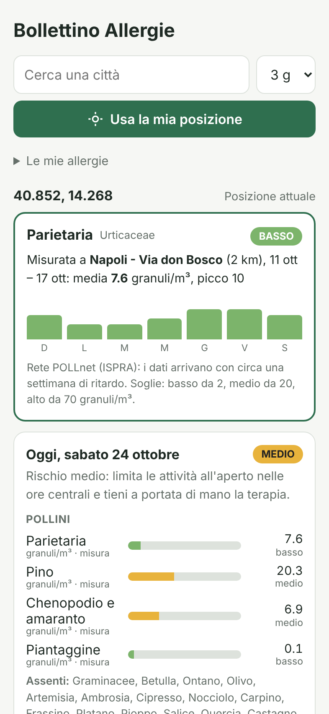

# Bollettino Allergie

Consulta il bollettino delle allergie per una città o località: livelli fino a 4 giorni per
**31 allergeni** (pollini, muffe e inquinanti), con un livello di rischio e un consiglio
pratico per ogni giorno.

| Categoria | Allergeni | Fonte del dato |
|---|---|---|
| Pollini, previsione | Graminacee, Betulla, Ontano, Olivo, Artemisia, Ambrosia | modello CAMS (Copernicus), solo Europa |
| Pollini, misura o stima | **Parietaria**, Cipresso, Nocciolo, Carpino, Frassino, Platano, Pioppo, Salice, Quercia, Castagno, Faggio, Pino, Acero, Olmo, Chenopodio e amaranto, Piantaggine, Romice | stazione POLLnet (ISPRA) più vicina; se manca, calendario pollinico |
| Pollini, stima stagionale | Tiglio | calendario pollinico, solo Europa |
| Muffe (spore) | Alternaria (misura o stima), Cladosporium (stima) | POLLnet / calendario pollinico |
| Qualità dell'aria, previsione | Polvere sahariana, PM10, PM2.5, Ozono, Biossido di azoto | modello CAMS, tutto il mondo |

**Previsione, misura e stima non sono la stessa cosa.** Nessun servizio gratuito fornisce
*previsioni* per parietaria, cipresso, muffe e gli altri pollini. Per questi l'app usa, in
ordine:

1. **la misura** della stazione della rete di monitoraggio aerobiologico
   [POLLnet](https://www.isprambiente.gov.it/) di ISPRA più vicina (entro 60 km), cioè le
   concentrazioni realmente rilevate nell'ultima settimana disponibile. I dati arrivano con
   circa una settimana di ritardo, quindi il bollettino mostra la settimana appena misurata;
2. se non c'è una stazione vicina con dati recenti, **la stima** dal calendario pollinico
   dell'Italia centrale, spostata in base a latitudine e quota con la legge bioclimatica di
   Hopkins (circa 4 giorni per grado di latitudine e ogni 122 m di quota; in autunno l'effetto
   si inverte). La stima dice *se* quell'allergene è in stagione, non quanto ce n'è.

Nella riga di comando le misure sono segnate con `°` e le stime con `*`; nell'app le misure
riportano la dicitura "misura" e le stime hanno barre più chiare.

### Parietaria

La parietaria (famiglia delle Urticaceae) è il polline allergenico più diffuso in Italia,
soprattutto al centro-sud e sulle coste, con una stagione lunghissima. Per questo ha un
**riquadro dedicato** in cima al bollettino, con la stazione di misura, la media e il
grafico dei 7 giorni misurati, e le soglie ufficiali POLLnet (basso da 2, medio da 20, alto
da 70 granuli/m³).

Le misure correggono il calendario dove il clima locale si discosta: il 24 ottobre 2026 la
stima indicava la parietaria quasi finita, mentre la stazione di Bolzano misurava ancora 62
granuli/m³ di media (livello medio) e Napoli 7,6 (basso).

Due accortezze sui dati POLLnet, gestite automaticamente:
- alcune stazioni pubblicano i giorni non ancora analizzati con tutte le concentrazioni a
  zero (per esempio Roma Tor Vergata, 4-10 ottobre 2026): un giorno reale ha sempre qualche
  polline o spora, quindi questi giorni sono considerati non misurati;
- alcuni record hanno date future (errori di inserimento) e vengono scartati.

Polveri e inquinanti non sono allergeni, ma irritano le vie respiratorie e peggiorano asma e
rinite allergica.

Non sono inclusi gli allergeni che non dipendono dal luogo né dal giorno (acari, peli di
animali, alimenti, farmaci, punture d'insetto): non hanno un bollettino.

- Nessuna dipendenza esterna: solo Python 3.10+ e la libreria standard.
- Dati gratuiti senza chiave API: [Open-Meteo](https://open-meteo.com/) (geocoding + Air Quality API,
  modello CAMS/Copernicus) e il servizio WFS della rete POLLnet di ISPRA (licenza CC BY 4.0).
  Pollini e muffe solo in Europa (misure solo in Italia); polveri e inquinanti ovunque.
- Quattro modi d'uso: **app Android** con geolocalizzazione, riga di comando, interfaccia web,
  libreria Python.

## App Android (APK)

L'app usa il **servizio di localizzazione dello smartphone** per mostrare subito il bollettino
del luogo in cui ti trovi. Scarica l'APK già compilato da
[`dist/BollettinoAllergie-1.2.apk`](dist/BollettinoAllergie-1.2.apk).

| Parietaria misurata (Napoli) | Le mie allergie | Profilo personale | Tema scuro |
|---|---|---|---|
|  |  |  |  |

*Il primo screenshot usa i dati reali del 24 ottobre 2026; gli altri i dati simulati di Roma a
maggio (vedi Esempi).*

**Installazione:** apri il file `.apk` sul telefono (Android 8.0 o successivo) e consenti
l'installazione da origini sconosciute quando viene richiesto. Al primo avvio l'app chiede il
permesso di posizione.

**Funzionamento:**
- all'avvio l'app rileva la posizione (tasto *Usa la mia posizione* per aggiornarla) e mostra il
  nome della località e il bollettino a 1-4 giorni;
- chiede solo la **posizione approssimativa**: basta, perché il modello dei pollini ha una
  griglia di circa 10 km, e protegge la privacy;
- se il permesso è negato o il GPS è spento puoi **cercare una città**; al riavvio, se la
  posizione non è disponibile, viene riproposta l'ultima località consultata;
- risultati divisi in pollini, muffe e qualità dell'aria; gli allergeni assenti sono riassunti
  in una riga per non allungare la pagina;
- in *Le mie allergie* scegli tra i 31 allergeni quelli che ti riguardano (la scelta viene
  ricordata, anche quella fatta con la versione 1.0);
- supporta tema chiaro e scuro.

**Come è fatta:** un'app nativa in Kotlin (`android/`) che ottiene la posizione dal
`LocationManager` di Android e la passa all'interfaccia web contenuta nell'app
(`android/app/src/main/assets/www/`). L'interfaccia interroga direttamente Open-Meteo dal
telefono: non serve alcun server. Il servizio POLLnet di ISPRA rifiuta le richieste fatte da
una pagina web (CORS), quindi le sue misure vengono scaricate dal codice nativo, che accetta
solo quell'indirizzo; l'elenco delle stazioni resta in memoria per una settimana. Il nome
della località viene da BigDataCloud (reverse geocoding gratuito, senza chiave). Il catalogo
degli allergeni (`bollettino_allergie/catalogo/allergeni.json`) è condiviso con il pacchetto
Python e viene copiato nell'APK durante la build; la logica (`bollettino.js`, `pollnet.js`)
rispecchia quella Python e i test verificano che diano gli stessi risultati.

**Compilare l'APK** (servono JDK 17+ e l'Android SDK):

```bash
cd android
echo "sdk.dir=/percorso/android-sdk" > local.properties   # oppure ANDROID_HOME
./gradlew assembleDebug
# -> app/build/outputs/apk/debug/app-debug.apk
```

L'APK in `dist/` è firmato con una chiave di debug, quindi va bene per installarlo a mano ma
non per il Play Store. Per pubblicarlo serve una build `release` firmata con una tua chiave.

## Come si usa

### Riga di comando

```bash
python -m bollettino_allergie Milano                          # bollettino a 3 giorni
python -m bollettino_allergie Firenze --giorni 4              # 1-4 giorni
python -m bollettino_allergie Roma -a cipresso,parietaria,pm10 # solo le tue allergie
python -m bollettino_allergie Roma --completo                 # mostra anche gli assenti
python -m bollettino_allergie Napoli --senza-misure           # solo stime, senza stazioni POLLnet
python -m bollettino_allergie Bari --json                     # output JSON
python -m bollettino_allergie --elenco                        # tutti gli allergeni disponibili
```

Output (Roma, 20 maggio, dati simulati con un episodio di polvere sahariana; `*` = stima stagionale):

```
2026-05-20  rischio complessivo: ALTO
  Pollini
    Graminacee               35.0   63.0 granuli/m³ █ alto
    Olivo                    19.0   34.2 granuli/m³ ▅ medio
    Parietaria*               2.8   n.d.            █ alto
    Quercia*                  2.5   n.d.            █ alto
    Pino*                     1.8   n.d.            ▅ medio
    ...
    assenti: Betulla, Ontano, Artemisia, Ambrosia, Cipresso, Nocciolo, Frassino, ...
  Muffe (spore)
    Alternaria*               1.2   n.d.            ▂ basso
    Cladosporium*             2.2   n.d.            ▅ medio
  Qualità dell'aria
    Polvere sahariana        70.0  126.0 µg/m³      ▅ medio
    PM10                     60.0  108.0 µg/m³      █ alto
    Ozono                    80.0  144.0 µg/m³      █ alto
    ...
  → Rischio alto: evita sforzi all'aperto, ... Aria inquinata: polveri e ozono irritano ...
```

### Interfaccia web

```bash
python -m bollettino_allergie --web --porta 8000
# apri http://127.0.0.1:8000
```


È disponibile anche l'endpoint JSON:
`GET /api/bollettino?luogo=Roma&giorni=3&allergie=graminacee,cipresso`

### Libreria

```python
from bollettino_allergie import cerca_luogo, scarica_previsioni, crea_bollettino, cerca_allergeni, pollnet

luogo = cerca_luogo("Torino")
misure = pollnet.scarica_misure(luogo.latitudine, luogo.longitudine)  # stazioni POLLnet vicine
b = crea_bollettino(luogo, scarica_previsioni(luogo, giorni=3),
                    cerca_allergeni(["ambrosia", "parietaria", "alternaria", "ozono"]), misure)
for giorno in b.giorni:
    print(giorno.data, giorno.livello_massimo, giorno.consiglio)
```

## Esempi

`esempi/esempi.py` mostra quattro casi d'uso:

| # | Scenario | Cosa mostra |
|---|----------|-------------|
| 1 | Roma, maggio | Tutti i 31 allergeni: olivo e graminacee previsti, quercia e parietaria stimate, polvere sahariana |
| 2 | Milano, aprile | Profilo personale: Betulaceae, cipresso, platano e, per l'asma, PM10 e NO₂ |
| 3 | Milano, fine agosto | Uso programmatico: giorni da evitare per ambrosia, Alternaria e ozono |
| 4 | Napoli, Bolzano, Roma | Parietaria misurata dalle stazioni POLLnet (istantanea reale del 24/10/2026) e ripiego sulla stima dove la stazione non ha dati validi |
| 5 | Firenze, oggi | Consultazione reale via API, con le misure POLLnet (`--live`) |

```bash
python esempi/esempi.py          # scenari 1-4, offline
python esempi/esempi.py --live   # aggiunge lo scenario 5 con dati reali
```

Gli scenari 1-3 usano dati **simulati** in `esempi/dati/` (stesso formato dell'API,
generati da `esempi/genera_dati.py`), così gli esempi sono significativi anche
fuori stagione, quando i pollini reali sono vicini a zero. Lo scenario 4 usa
un'istantanea **reale** del servizio POLLnet (`esempi/dati/pollnet_24ottobre.json`),
usata anche dai test.

## Come si calcola il livello

Per le **previsioni** si calcola il valore giornaliero dalle concentrazioni orarie (media;
picco orario per ozono e biossido di azoto) e lo si confronta con soglie indicative: rete
aerobiologica italiana (AAITO/POLLnet) per i pollini, indice europeo della qualità dell'aria
(EAQI) per gli inquinanti.

| Allergene | Unità | Basso | Medio | Alto |
|-----------|-------|-------|-------|------|
| Graminacee | granuli/m³ | ≥ 0.6 | ≥ 10 | ≥ 30 |
| Betulla, Ontano | granuli/m³ | ≥ 0.6 | ≥ 16 | ≥ 50 |
| Olivo, Artemisia, Ambrosia | granuli/m³ | ≥ 0.6 | ≥ 5 | ≥ 25 |
| Polvere sahariana | µg/m³ | ≥ 20 | ≥ 50 | ≥ 100 |
| PM10 | µg/m³ | ≥ 20 | ≥ 40 | ≥ 50 |
| PM2.5 | µg/m³ | ≥ 10 | ≥ 20 | ≥ 25 |
| Ozono (picco) | µg/m³ | ≥ 50 | ≥ 100 | ≥ 130 |
| Biossido di azoto (picco) | µg/m³ | ≥ 40 | ≥ 90 | ≥ 120 |

Per le **stime stagionali** ogni allergene ha un calendario di 12 valori mensili (0 assente,
1 basso, 2 medio, 3 alto), interpolato giorno per giorno e spostato con la legge di Hopkins.
Soglie e calendari sono nel file `bollettino_allergie/catalogo/allergeni.json`: modificandolo
si aggiornano sia il pacchetto Python sia l'app.

Per le **misure POLLnet** si usa la media degli ultimi 7 giorni misurati (almeno 3 valori,
dati non più vecchi di 14 giorni) e le soglie ufficiali della rete per ogni particella,
riportate nel catalogo (parietaria: 2 / 20 / 70 granuli/m³; cipresso: 4 / 30 / 90; ...).

Il rischio complessivo del giorno è il livello più alto tra gli allergeni considerati.
Previsioni e stime sono indicative: il bollettino non sostituisce il parere del medico o
dell'allergologo.

## Test

```bash
python -m unittest -v                          # pacchetto Python
node --test android/test/bollettino.test.js    # logica dell'app Android e confronto con Python
```

I test non richiedono la rete.
